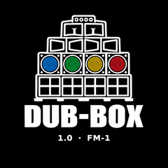

<h1 align="center">DUB-BOX</h1>

<p align="center">
  A dub station firmware for the M-VAVE FM-1 — the USB/BT audio router with the
  siren, the tape echo, the DJ filter and the isolator on their own pages
</p>

<p align="center">
  
</p>

<p align="center">
  <a href="https://github.com/altessproduction/DUB-BOX-FM1/actions/workflows/firmware.yml"></a>
</p>

# What it is

DUB-BOX is [fm1-audio-router](https://github.com/maxravedj/fm1-audio-router) —
the FM-1's 2-in/2-out USB sound card and Bluetooth receiver — with the dub
modules of [sloop-DUB](https://github.com/altessproduction/sloop-dub-fm1)
ported on top. No sequencer, no synths: the dub tools, over whatever you feed
it — your DAW over USB, a phone over Bluetooth, a mixer, a record player.

Press **OCT−** and the DUB screen takes over the display, five pages — sloop's
own page set, each page's four settings on K1–K4:

| Page | What it does |
| --- | --- |
| **DUB** | K1 the DJ filter (bipolar: lowpass left, highpass right, FLAT at the center detent, sweeps glide), K2 the mix, K3 the **USB in's send** into the tape echo, K4 the **BT in's** — two throws read separately, 0 DRY at boot. The **eighth black key** switches the module. |
| **SIREN** | K1 the LFO type (WAIL, HILO, RAMP, SWEEP, SPACE), K2 the wave (SQR, PLS, SAW, TRI, SIN), K3 pitch 220–1200 Hz, K4 the send into the tape echo (0 DRY — the siren's tail rings there). The **last black key** is its gate: hold it to sing, release it to stop (the delay tail rings on) — from any screen. |
| **SIREN 2** | K1 rate 1–16 Hz, K2 depth (the pitch sweep, two octaves at 127), K3 the LFO's symmetry, K4 the level the last black key sounds at. |
| **DELAY** | The tape echo: K1 time 40–740 ms, K2 feedback, K3 level, K4 tone (the repeats' damping). The time glides like a tape's sag, the head wanders (wow 0.7 Hz, flutter 6.3 Hz), the repeats pass the damping and a soft clip, warming pass by pass. |
| **ISO** | Four bands — SUB 90, BASS 420, MIDS 2600, TOPS — K1/K2/K3/K4 their gains −24…+12 dB, the **first four black keys** (OP1–OP4) kill them; all four at once is the total kill. SEL lifts every kill. |

**The keys are the performance**, on every screen, no page needed: the first
four black keys (F♯3 G♯3 A♯3 C♯4 — the OP1–OP4 prints) toggle the ISO band
kills — SUB, BASS, MIDS, TOPS, each key's LED lit while its band is down — the
eighth black key (A♯4, the GLO print) turns the DUB module on and off, its
LED lit while the module is on (the module is on at boot), the ninth and tenth
(C♯5, the MONO print, and D♯5) arm the USB in and BT in sends into the delay,
each LED lit while armed (both arms on at boot, the levels at 0), and the last
black key (F♯5) is the siren's gate: hold it and it sings at its LEVEL,
release it and it stops — what it threw into the tape keeps ringing, the tail
is the delay's. All four kills together is the total kill, SEL on the ISO page
lifts them, and a kill wakes the module (DUB ON) if it was off. The mixer's
white mute/solo keys (F3–B3/F4–B4) keep their role on the mixer.

**PLAY** mutes the master — the drop. Everything persists across boots
(settings v19), and the dub chain rests bit-transparent when off.

Under it, the router runs whole: USB audio in/out (UAC1, 44.1 kHz, asynchronous
feedback), Bluetooth receiver with SBC, AAC, aptX and aptX HD on its own
clean-room stack (no vendor blobs), mixer with trims/mutes/solos, five-band EQ
and peak limiter, meters, waveforms and a 40-band spectrum.

# Install

DUB-BOX runs on the [m-bootloader](https://github.com/jvitkauskas/m-bootloader)
(community bootloader, installed once with
[M-Flasher](https://github.com/jvitkauskas/m-flasher)):

1. Back your unit up first — a settings export is not a firmware backup
   ([MvaveFM1Unbricker](https://github.com/Quixotic7/MvaveFM1Unbricker)).
2. Download [`dub-box-1.0.8.fwsc`](docs/firmware/dub-box-1.0.8.fwsc) (or the
   release asset) and check its SHA-256 (`docs/firmware/SHA256SUMS`).
3. Turn the FM-1 off, on while holding **REC**.
4. Flash with M-Flasher — bootloader replacement **disabled**, settings erase
   **unchecked**.
5. Press **OCT−** and dub.

The web install page walks through it with the checksums:
**[docs/index.html → installer](https://altessproduction.github.io/DUB-BOX-FM1/installer/)**
— and the **[web emulator](https://altessproduction.github.io/DUB-BOX-FM1/dub/)**
runs the **real firmware** in the browser: `app.wasm` is the whole DUB-BOX app
(UI, menus, sound, saved settings) compiled to WebAssembly by fm1-base's
`tools/build.py --web` — not a re-implementation. The page's faceplate is the
FM-1 (after sloop-DUB's emulator); the sound source (built-in dub beat,
microphone, audio file) enters through the emulated USB port, the same path a
DAW takes on the device. Browser-only limits: the Bluetooth receiver stays
offline (no radio) and the settings are kept in the browser's storage.

# Build

```sh
python src/scripts/setup_build.py
python src/scripts/build_gateway.py
python src/scripts/package_gateway.py
```

`dist/dub-box.fwsc` is refreshed after every successful target build. Host
tests: `python src/scripts/build_gateway.py --host && python src/scripts/test_gateway.py`
— 445 checks, the dub modules included (`dub_module_test`). See
[docs/BUILD.md](docs/BUILD.md) for the whole recipe and the release flow.
The firmware answers its own hub ID, plain **FM-1_2345** — unique on the hub
(sloop-DUB keeps FM-1_234); the Git tag names the release only.

# Licensing

The router platform is MPL-2.0 (MAX RAVE); the dub modules and the DUB screen
are GPL-3.0-only, ported from sloop-DUB. The combined firmware is distributed
GPL-3.0-only — see [LICENSING.md](LICENSING.md), [CREDITS.md](CREDITS.md) and
[UPSTREAM.md](docs/UPSTREAM.md). M-VAVE and FM-1 are trademarks of their
respective owners; DUB-BOX is not affiliated with them.

You can also try DUB-BOX in the browser, no flashing needed, in the free community [FM-1 Emulator](https://fm1-emulator.atst.tools/).
